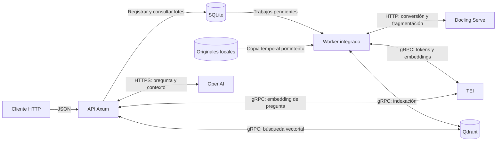
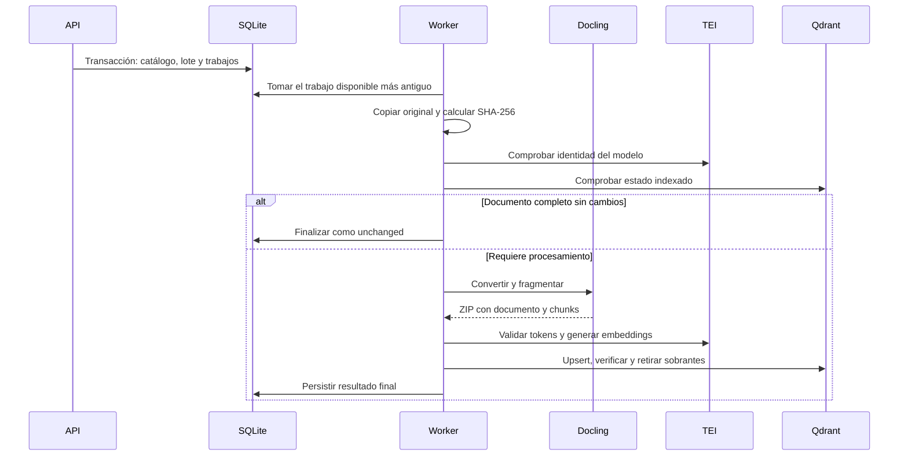

# Arquitectura

## Contexto y alcance

Tisenda es una API HTTP y una biblioteca Rust para consultar documentación interna mediante RAG. El binario inicia el servidor Axum y un worker de ingesta integrado; Tokio ejecuta las operaciones asíncronas. Los originales se seleccionan en el sistema de archivos del servidor.

El sistema se comunica con Docling Serve, TEI y Qdrant, que [Compose](../compose.yaml) ejecuta en el host, y con OpenAI para generar respuestas. La topología actual es una instancia con almacenamiento local.

| Servicio | Puerto local | Protocolo usado por la API |
| --- | --- | --- |
| API | 3000 (`HTTP_BIND`) | HTTP |
| Docling Serve | 5001 | HTTP |
| TEI | 8080 | gRPC |
| Qdrant | 6334 (6333 para HTTP y panel) | gRPC |
| OpenAI | — | HTTPS, API Responses; modelo predeterminado `gpt-5-mini` |

El comportamiento esperado de cada capacidad está en [specs/](specs/); este documento explica el diseño que lo implementa.

## Estructura principal

| Módulo o componente | Responsabilidad | Tecnología | Dependencias principales |
| --- | --- | --- | --- |
| [lib](../src/lib.rs) y [main](../src/main.rs) | Reexportaciones selectivas de la API pública; carga de configuración, logs e inicio del servicio | Rust 2024, Tokio | Todos los módulos |
| [server](../src/server.rs) | Rutas, límites HTTP, OpenAPI, Scalar y cierre supervisado | Axum, tower-http, utoipa, Scalar | ingestions, answer |
| [ingestions](../src/ingestions.rs) | Selección segura, catálogo, cola, informes, reintentos y worker | SQLite mediante sqlx | docling, ingest, tei, qdrant |
| [docling](../src/docling.rs) | Cliente de conversión, formatos admitidos, ZIP, fragmentación y procedencia | Docling Serve por HTTP (reqwest), zip | Docling Serve |
| [ingest](../src/ingest.rs) | Validación de documentos convertidos, comparación con el índice y escrituras | qdrant-client | tei, qdrant |
| [answer](../src/answer.rs) | Recuperación, construcción del contexto, generación y citas | Rig, OpenAI | tei, qdrant |
| [tei](../src/tei.rs) | Tokenización, embeddings e identidad del modelo | TEI por gRPC (Tonic, cliente generado por [build.rs](../build.rs) desde [tei.v1](../proto/tei/v1/tei.proto)) | TEI |
| [qdrant](../src/qdrant.rs) | Colecciones, alias, metadatos y búsqueda vectorial | Qdrant por gRPC (qdrant-client) | Qdrant |
| [documents](../src/documents.rs), [config](../src/config.rs) y [logging](../src/logging.rs) | Tipos documentales, configuración y diagnóstico | dotenvy, tracing | — |

Las convenciones de módulos están en [AGENTS.md](../AGENTS.md).

## Flujos relevantes

### Ingesta

`POST /ingestions` resuelve la selección y registra documentos, lote y trabajos en una transacción SQLite. El worker procesa después un trabajo a la vez:

- **Copia:** cada intento copia el original en bloques de 64 KiB bajo un espacio temporal propio y calcula su SHA-256.
- **Conversión:** Docling recibe un original por tarea asíncrona y devuelve un `DoclingDocument` y chunks JSONL generados con HybridChunker. La API consulta cada dos segundos y valida el ZIP, sus recursos y su correspondencia con el original.
- **Tokens y embeddings:** TEI cuenta los tokens reales; si un fragmento excede el límite, se refragmenta el JSON convertido. Los embeddings usan `truncate=false`, normalización y lotes de hasta 16 fragmentos.
- **Indexación:** lee el manifiesto de la colección, escribe los puntos, confirma IDs y metadatos, elimina los sobrantes del documento y verifica el conteo. El alias inicial se publica tras la primera indexación confirmada.

La función pública `ingest_documents` recibe `IngestDocument` ya convertido y un `document_id` persistido por quien la llama; omite el catálogo SQLite y la conversión.

Implementación: [selección y copia](../src/ingestions/source.rs), [cola](../src/ingestions/store.rs), [orquestación](../src/ingestions/manager.rs), [worker](../src/ingestions/worker.rs), [cliente Docling](../src/docling/client.rs), [comprobación previa](../src/ingest/preflight.rs) y [escritura](../src/ingest/write.rs).

### Consulta

1. `POST /query` busca el alias activo y comprueba esquema, configuración de embeddings e identidad del modelo servido por TEI.
2. TEI vectoriza la pregunta. Rig solicita a Qdrant hasta `min(2 × TOP_K, 50)` candidatos con búsqueda densa y distancia coseno.
3. El contexto se construye con los candidatos que cumplen los límites de [query](specs/query.md); el presupuesto de 12 000 bytes incluye las etiquetas.
4. OpenAI genera la respuesta con marcadores `[n]` a partir de la pregunta y el contexto; el validador comprueba los marcadores y permite una corrección.

Implementación: [consulta](../src/answer/pipeline.rs), [contexto](../src/answer/context.rs), [generación](../src/answer/generation.rs) y [citas](../src/answer/citations.rs).

### Arranque y apagado

Al iniciar, el binario carga `.env`, instala los logs y prepara el servicio en este orden; cualquier fallo detiene el proceso:

1. Valida la configuración: valores numéricos, `TOP_K` entre 1 y 50, URL de Docling sin credenciales y modo de exportación de imágenes.
2. Abre `DOCUMENTS_ROOT`, que debe existir y ser un directorio.
3. Toma el bloqueo exclusivo `<INGESTIONS_DB_PATH>.lock`; si otra instancia lo tiene, no arranca.
4. Aplica las migraciones SQLite; una base con un esquema anterior impide arrancar.
5. Elimina los temporales `rag-document-*` de intentos anteriores.
6. Marca como `interrupted` los intentos abiertos y devuelve a `pending`, con recuperación, los trabajos en `processing`.
7. Inicia el worker y el servidor HTTP.

Ante SIGINT o SIGTERM, el servidor deja de aceptar conexiones y el worker deja de tomar trabajos; el trabajo activo dispone de 30 segundos antes de interrumpirse. Si el worker se detiene por un error de persistencia o un pánico, la API inicia el mismo cierre ordenado.

Implementación: [main](../src/main.rs), [servidor](../src/server/http.rs), [cola](../src/ingestions/store.rs) y [worker](../src/ingestions/worker.rs).

## Datos e integraciones

| Estado | Propietario y persistencia |
| --- | --- |
| Originales | Carpeta `DOCUMENTS_ROOT`; la API los lee y conserva su ubicación |
| Identidades, cola e historial | SQLite en `INGESTIONS_DB_PATH` |
| Vectores y fragmentos con procedencia | Qdrant, volumen `qdrant-data` |
| Copias por intento y exportación Docling | Temporales bajo `INGESTIONS_TEMP_ROOT`, eliminables tras el procesamiento |
| Caché de embeddings | TEI, volumen `tei-bge-m3-cache` |

Originales y SQLite son los datos esenciales: con ellos se reconstruye el índice conservando las identidades documentales.

### Catálogo SQLite

| Tabla | Función e invariantes principales |
| --- | --- |
| `documents` | `id` persistente, `source_key` única, nombre visible y fecha de registro |
| `batches` | Agrupa una selección y registra su finalización |
| `jobs` | Referencia lote y documento; conserva ordinal, estado, informe e intentos |
| `attempts` | Historial por trabajo y número de intento; `outcome` registra el estado final o `interrupted` |

SQLite guarda los UUID como texto y las fechas como milisegundos UTC desde Unix epoch. Usa WAL, `synchronous=FULL`, dos conexiones y espera de bloqueo de cinco segundos. Esquema: [migración](../migrations/0001_ingestions.sql).

| Dato | Significado |
| --- | --- |
| `source_key` | Ruta normalizada relativa a `DOCUMENTS_ROOT`, por ejemplo `impresoras/manual.pdf` |
| `original_sha256` | SHA-256 de los bytes copiados en ese intento |
| `content_hash` | SHA-256 de los fragmentos convertidos, serializados con orden canónico de claves JSON |
| `embedding_version` | Huella de modelo, dimensión y preprocesamiento |
| `pipeline_version` | Huella del procesamiento, presupuesto de fragmentación e identidad del modelo, incluida su revisión |
| `corpus_id` | UUID interno de una colección; cambia al reconstruirla aunque los documentos no cambien |

### Colección Qdrant

La colección física se llama `rag_<embedding_version>_<UUIDv5(alias)>` y el alias `QDRANT_ALIAS` apunta a ella; se publica tras la primera indexación confirmada. Sus metadatos `rag_ingest` registran esquema, origen, alias, `embedding_version`, `corpus_id` e identidad del modelo (revisión y tipo numérico), y se validan antes de cada ingesta y consulta. Usa vector denso de dimensión `EMBEDDING_DIMENSION` con distancia coseno, esquema de metadatos **4**, índice de payload `uuid` para `document_id` y `keyword` para `source_key`. Cada punto conserva texto, localizador, `document_id`, hashes, perfil y procedencia Docling. El ID del punto es `UUIDv5(document_id, chunk_index_u64_be)`: la posición del fragmento desde cero, en ocho bytes big-endian.

Implementación: [derivaciones e índice](../src/ingest/index_state.rs), [preparación y hash](../src/ingest/document_processor.rs) y [colecciones](../src/qdrant.rs).

### Dónde circulan los datos

| Destino | Datos enviados o conservados |
| --- | --- |
| Docling | Original completo; JSON convertido al solicitar refragmentación |
| TEI | Texto de fragmentos y preguntas |
| Qdrant | Vectores, texto, nombres, rutas relativas, identidad y procedencia |
| SQLite | Catálogo, selección, estado e informes; errores y advertencias pueden contener detalles de archivos o servicios |
| OpenAI | Pregunta y contexto seleccionado; al corregir citas, también la respuesta anterior |
| Cliente HTTP | Respuesta, extractos citados, metadatos e informes de ingesta |

Los logs propios omiten preguntas, respuestas, contenido y credenciales; los informes, errores HTTP y logs de dependencias no tienen necesariamente esa restricción.

El contrato HTTP se genera desde los handlers y tipos Rust: [Scalar](http://127.0.0.1:3000/docs) y [OpenAPI](http://127.0.0.1:3000/openapi.json).

## Restricciones e invariantes

- Catálogo, lote y trabajos se registran en una transacción; una `source_key` corresponde a un único `document_id`, que persiste aunque el procesamiento falle.
- Cada trabajo referencia a su documento, y una restricción exige que su informe contenga el mismo `document_id`.
- Una SQLite corresponde a una raíz documental lógica y a una sola instancia; base, WAL y bloqueo deben estar en almacenamiento local.
- SQLite y Qdrant no comparten transacción: una interrupción puede dejar versiones mezcladas hasta una nueva ejecución. Reutilizar IDs de punto evita duplicados de una misma posición, pero no garantiza ejecución exactamente una vez.
- El worker procesa un documento a la vez, en orden de llegada entre lotes; HTTP admite concurrencia. Las escrituras en Qdrant se serializan con un bloqueo de archivo en el directorio temporal del sistema, por endpoint y alias; no es coordinación distribuida.
- Las escrituras se aplican con confirmación de Qdrant (`wait`), y se verifica el conteo exacto de la colección tras cada documento.
- `x-request-id` lo genera siempre la API (UUIDv4) y reemplaza el que envíe el cliente.
- El cliente Docling no sigue redirecciones ni reintenta a nivel HTTP, tiene un tiempo de conexión de 10 s y limita las respuestas de control a 1 MiB. TEI usa deadlines de 15 s para `Info` y de 120 s para `Tokenize` y `Embed`, con hasta 16 embeddings concurrentes.
- La selección usa rutas relativas normalizadas, abre cada componente con `openat` y `NOFOLLOW`, y comprueba el tamaño antes y durante la copia.
- El ZIP convertido tiene límites de entradas y expansión; se rechazan nombres peligrosos, duplicados, symlinks y conflictos archivo/directorio. Las referencias de imagen externas no se descargan.
- Los UUID identifican recursos, pero no son credenciales: v7 incorpora tiempo y v5 es predecible si se conocen sus entradas.

## Decisiones principales

Decisiones fundamentales de tecnología y estructura que dan forma al sistema.

| Decisión | Motivo |
| --- | --- |
| UUIDv7 para `document_id`, `batch_id` y `job_id` | Identificadores persistentes con componente temporal y orden cronológico aproximado |
| UUIDv5 para los IDs de punto Qdrant, el sufijo de colección y el espacio temporal de la cola | Recalcular el mismo identificador a partir del documento y la posición, del alias o de la ruta de SQLite; repetir una escritura sobrescribe el mismo punto |
| UUIDv4 para `x-request-id`, `query_id` y `corpus_id` | Unicidad aleatoria sin orden temporal ni derivación |
| SHA-1 de UUIDv5 solo para derivar IDs; SHA-256 para huellas de contenido | Separar derivación de identificadores y detección de cambios |
| Cola persistente en SQLite con worker integrado y secuencial | Aceptar lotes sin depender de los servicios externos y recuperar trabajos interrumpidos en un solo proceso |
| Revisión del modelo de embeddings fijada y validada | Garantizar compatibilidad entre API, TEI e índice; una colección incompatible se rechaza |

## Límites conocidos

- **Acceso:** no hay autenticación, permisos por documento, separación por usuario ni TLS. Tampoco limitación de frecuencia ni CORS para una SPA en otro origen. `HTTP_BIND` usa `0.0.0.0:3000` por defecto.
- **Dependencias:** Compose publica Qdrant, TEI y Docling solo en loopback y sin autenticación. El cliente no expone una variable para la API key de Qdrant.
- **Contenedor Docling:** solicita CDI NVIDIA incluso con `DOCLING_DEVICE=cpu`, accede al host y desactiva el etiquetado SELinux. No hay antivirus ni sandbox propio para documentos no confiables.
- **RAG:** el prompt trata los documentos como datos no confiables, pero eso no aísla frente a prompt injection. El validador de citas comprueba sintaxis y existencia de `[n]`, no el respaldo semántico ni la cobertura de las afirmaciones.
- **Capacidad:** la indexación lee en memoria el manifiesto de toda la colección por documento, así que su coste crece con el índice. No hay purga de historial ni cupo global de trabajos.
- **Observabilidad:** sin métricas Prometheus ni estado global de cola. La cola de logs admite 8192 líneas y descarta eventos al saturarse (`logs_dropped`). `GET /health` no comprueba dependencias.
- **Scalar:** carga JavaScript desde `cdn.jsdelivr.net`.
- **Funciones pendientes:** carga de archivos desde una SPA, almacenamiento S3, renombrado y eliminación documental.
